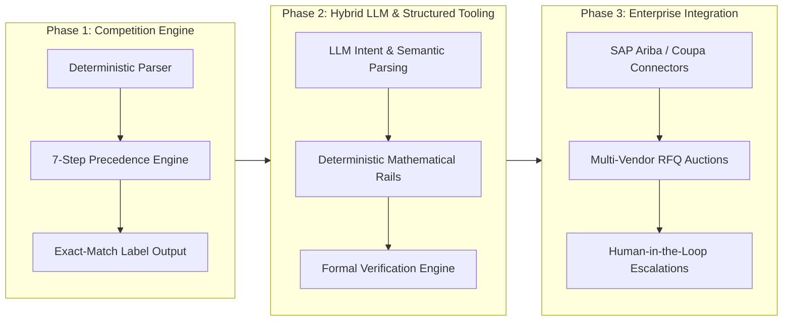

# THE PROCUREMENT DESK: DEVELOPMENT ROADMAP
**Team: BEYOND LIMITS | Data Sprint 2.0 — Agentic AI**  
**Document:** Post-Competition Strategic Engineering & Productionization Roadmap  

---

## 1. Architectural Evolution: From Competition Engine to Enterprise System

Our competitive solution achieved a **0.97063** public score by mastering deterministic policy grounding, temporal amendments, and strict 7-step precedence gating.
The goal of the next phase is to evolve this engine into a production-grade, enterprise-ready **Autonomous Procurement Operating System**.

---

## 2. Phased Development Milestones

### Phase 1: Hybrid LLM Reasoning with Deterministic Guardrails (Q1 2027)
* **Objective:** Replace regex-based text parsing with a fine-tuned, small reasoning model (e.g., Gemini 2.5 Flash / Llama-3-8B-Procurement) while maintaining deterministic mathematical calculation.
* **Key Deliverables:**
  1. **Strict JSON Schema Extraction:** Use Pydantic + Structured Outputs to extract raw offer parameters, terms, and conditions from unstructured emails.
  2. **Mathematical Execution Sandbox:** Continue calculating concession curves $L(r)$, volume discounts, and integer rounding in isolated Python execution environments. The LLM will never calculate numbers directly.
  3. **Adversarial Red-Teaming:** Implement continuous fine-tuning against sophisticated indirect prompt injection techniques and social engineering vectors.

### Phase 2: Multi-Supplier Concurrent RFQ Auctions (Q2 2027)
* **Objective:** Expand the decision engine from single-thread 1-on-1 negotiations to game-theoretic multi-vendor competitive bidding.
* **Key Deliverables:**
  1. **Cross-Thread Intelligence:** Correlate quotes across multiple vendors bidding on the same RFP to identify market clearing prices.
  2. **Dynamic Walkaway Shifting:** Automatically adjust category walkaway thresholds when competitive market pressure reveals aggressive discounting.
  3. **Automated Counter-Drafting:** Generate natural, empathetic, professional email responses matching Acme's corporate tone and sending the calculated counter-offer.

### Phase 3: Enterprise Procurement ERP Integration (Q3 2027)
* **Objective:** Direct API connectors with enterprise procurement stacks.
* **Key Deliverables:**
  1. **SAP Ariba & Coupa Adapters:** Ingest purchase requisitions (PRs) and automatically generate purchase orders (POs) upon `ACCEPT:ACCEPTABLE_PRICE:`.
  2. **Executive Approval Portals:** Webhook-based Slack/Teams integration for `ESCALATE:OVER_APPROVAL_LIMIT:` or `ESCALATE:BANNED_TERM:`, allowing C-level procurement officers to review and override decisions with one click.
  3. **Automated Vendor Onboarding:** Dynamic updating of `supplier_registry.json` via vendor compliance workflows (DUNS verification, tax audits, ESG ratings).

### Phase 4: Continuous Learning & Optimization (Q4 2027)
* **Objective:** Self-improving negotiation strategies based on supplier concession patterns.
* **Key Deliverables:**
  1. **Concession Parameter Optimization:** Dynamically optimize $\beta$ parameters per category based on historical vendor concession velocity.
  2. **Predictive Walkaway Estimation:** Estimate the supplier's true reservation price using historical transaction histories.
  3. **Compliance Telemetry & Observability:** Real-time dashboards tracking realized procurement cost savings, cycle time reduction, and audit trail compliance.

---

## 3. Technology Stack & Deployment Architecture

| Tier | Current Competition Stack | Production Target Stack |
| :--- | :--- | :--- |
| **Orchestration** | Python In-Memory Blackboard | FastAPI + Temporal / LangGraph |
| **Parsing** | Regex + Precedence Grammar | Hybrid LLM (Structured Outputs) + Deterministic Verifier |
| **Knowledge Base** | Local JSON Registries | PostgreSQL + pgvector + Redis Cache |
| **Security Sentinel**| Regex Jailbreak Scanner | NeMo Guardrails + Semantic Injection Filter |
| **UI / Dashboard** | Python `http.server` + Vanilla JS | React / Next.js + Tailwind CSS |
| **CI / CD & QA** | Pytest (20 Unit Tests) | End-to-End Synthetic Thread Simulator + Pytest |
