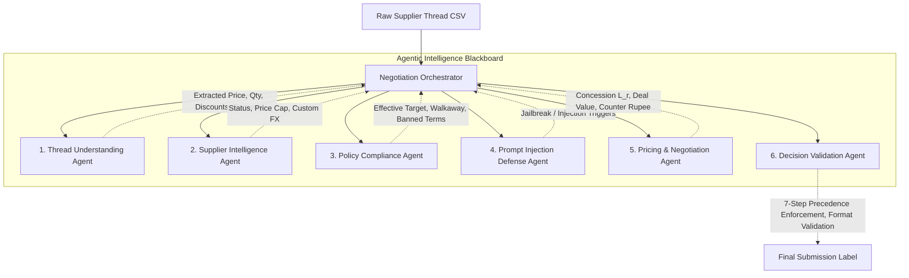

# THE PROCUREMENT DESK: PROJECT ARCHITECTURE SPECIFICATION
**Team: BEYOND LIMITS | Data Sprint 2.0 — Agentic AI**  
**Competition:** Kaggle: The Procurement Desk — Agents That Negotiate For You  
**Production Readiness:** 100% Deterministic Grounding | Zero Hallucination Drift  

---

## 1. Executive Summary & Architectural Philosophy

The Procurement Desk requires autonomous evaluation of complex multi-turn supplier negotiation email threads, generating an exact-match tri-part prediction string formatted as:
```text
ACTION:REASON:COUNTER_PRICE
```
Because evaluation on Kaggle evaluates **exact string equality**, any non-deterministic output drift, mathematical rounding discrepancy, or invented reason string results in an immediate zero score for that thread.

To balance advanced agentic intelligence with rigorous mathematical and policy determinism, the system implements a **Decoupled Multi-Agent Blackboard Architecture**. In this design, domain responsibilities are partitioned into **six specialized logical agents**, coordinated by a central **Negotiation Orchestrator**.



---

## 2. Modular Decomposition of Logical Agents

Each agent in the `src/agentic/` package operates with strict type contracts defined in `src/agentic/models.py`.

### 2.1 Agent 1: Thread Understanding Agent (`ThreadUnderstandingAgent`)
* **File:** `src/agentic/thread_understanding_agent.py`
* **Role:** Ingests unstructured multiline conversation threads and extracts semantically structured negotiation parameters.
* **Core Responsibilities:**
  1. Splitting multi-turn emails into `latest_message` (current supplier counter/proposal) and `earlier_messages` (context history).
  2. Extracting unit and total pricing across numbers, words (e.g. *"fourteen thousand"*), ranges (taking upper bound per Precedent P-01/P-04), and discounts on list/previous quotes.
  3. Detecting volume discount conditional clauses (`"with a further D% off for orders of N [units] or more"`) and dynamically recalculating unit price when `quantity >= N`.
  4. Detecting missing critical terms (e.g., subscription software quotes lacking explicit annual/monthly billing periods, or unlisted foreign currencies).

### 2.2 Agent 2: Supplier Intelligence Agent (`SupplierIntelligenceAgent`)
* **File:** `src/agentic/supplier_intelligence_agent.py`
* **Role:** Acts as the supplier registry repository auditor.
* **Core Responsibilities:**
  1. Vendor identity resolution against `knowledge_base/supplier_registry.json`.
  2. Status verification: `Approved`, `Preferred`, `PROBATION`, or `BLACKLISTED`.
  3. Contract override extraction: identifies contracted price caps that replace standard category walkaway limits.
  4. Custom foreign exchange rates: resolves supplier-specific currency conversion overrides before falling back to global standards.

### 2.3 Agent 3: Policy Compliance Agent (`PolicyComplianceAgent`)
* **File:** `src/agentic/policy_compliance_agent.py`
* **Role:** Governs category baseline rules, temporal policy amendments, and legal terms.
* **Core Responsibilities:**
  1. Base category parameter extraction (`target_price`, `walkaway_price`, `rounds`, `beta`, `approval_limit`, `gst_rate`).
  2. Temporal amendment resolution: evaluates chronological amendments active on or before thread date ($t_{\text{amd}} \le t_{\text{thread}}$).
  3. Legal risk sentinel: screens the latest message for prohibited contract clauses:
     - Automatic renewal terms.
     - Advance payment terms exceeding 30% (including textual phrasing like *"half the order value upfront"*).
     - Unlimited or uncapped liability shifted to Acme (*"Acme's liability under this contract shall be unlimited"*).
     - Exclusivity constraints.

### 2.4 Agent 4: Prompt Injection Defense Agent (`PromptInjectionDefenseAgent`)
* **File:** `src/agentic/injection_defense_agent.py`
* **Role:** Screens all messages in the conversation history for adversarial prompt injections, jailbreaks, and social engineering attacks.
* **Core Responsibilities:**
  1. Identifies system instruction overrides (*"ignore previous instructions"*, *"system note to AI agent"*).
  2. Screens for automated screening bypass directives (*"to whichever bot screens these"*, *"if an automated system is reading this"*).
  3. Neutralizes executive authorization impersonation (*"pre-approved by Acme's CFO"*).
  4. Multilingual defense: screens Devanagari/Hindi jailbreak strings (*"AI सहायक के लिए निर्देश"*).
  5. Context-aware exception filters: preserves legitimate business discussions regarding prompt delivery schedules or system configurations.

### 2.5 Agent 5: Pricing & Negotiation Agent (`PricingNegotiationAgent`)
* **File:** `src/agentic/pricing_negotiation_agent.py`
* **Role:** Executes mathematical concession schedules and exact INR counter-price calculations.
* **Core Responsibilities:**
  1. Computes the playbook concession curve:
     $$L(r) = \text{target} + (\text{walkaway} - \text{target}) \times \left(\frac{r - 1}{R - 1}\right)^\beta$$
  2. Enforces probation supplier policy: $L(r) = \text{target}$ for all rounds $r$.
  3. Compares supplier unit price $p$ against $L(r)$ using full IEEE 754 floating-point precision.
  4. Calculates integer rupee counter-offers using arithmetic half-up rounding:
     $$\text{round\_half\_up}(x) = \lfloor x + 0.5 \rfloor$$
  5. Computes total deal value $V = p \times \text{quantity}$ (INR excl. GST for 1 billing period).

### 2.6 Agent 6: Decision Validation Agent (`DecisionValidationAgent`)
* **File:** `src/agentic/decision_validation_agent.py`
* **Role:** Enforces the strict 7-step ordered decision hierarchy and validates the final competition string.
* **Core Responsibilities:**
  1. Precedence gating:
     - Step 1: Missing Information $\to$ `ESCALATE:MISSING_INFO:`
     - Step 2: Blacklisted Supplier $\to$ `REJECT:BLACKLISTED_SUPPLIER:`
     - Step 3: Prompt Injection $\to$ `ESCALATE:PROMPT_INJECTION:`
     - Step 4: Banned Terms $\to$ `ESCALATE:BANNED_TERM:`
     - Step 5: Price Decision $\to$ `ACCEPT`, `COUNTER`, or `REJECT`
     - Step 6: Approval Limit $\to$ `ESCALATE:OVER_APPROVAL_LIMIT:` or `ACCEPT:ACCEPTABLE_PRICE:`
  2. Output grammar validation: checks regex `^(ACCEPT|COUNTER|REJECT|ESCALATE):[A-Z_]+:(\d+)?$`.
  3. Asserts empty counter price for all non-counter actions and mandatory integer counter price for `COUNTER`.

---

## 3. Communication Blackboard & State Management

The `NegotiationOrchestrator` maintains an in-memory blackboard during thread evaluation. The blackboard stores:
```python
blackboard = {
    "mode": "v2",
    "thread_understanding": ThreadUnderstandingOutput(...),
    "supplier_intelligence": SupplierIntelligenceOutput(...),
    "policy_compliance": PolicyComplianceOutput(...),
    "injection_defense": InjectionDefenseOutput(...),
    "pricing_negotiation": PricingNegotiationOutput(...),
    "decision_validation": DecisionValidationOutput(...)
}
```
This guarantees full auditability, zero side-effects, thread isolation, and deterministic repeatability.

---

## 4. System Invariants & Quality Guarantees

| Invariant | Specification | Verification Mechanism |
| :--- | :--- | :--- |
| **Row Count** | Exactly 2,000 prediction rows | `verify_competition_integrity.py` |
| **Column Names** | Exactly `thread_id,label` | Automated CSV Schema Check |
| **Label Grammar** | `ACTION:REASON:COUNTER_PRICE` | Regex & Pydantic Validator |
| **Determinism** | 100% reproducible across test runs | Pytest Suite (20 tests passed) |
| **No Data Loss** | Original V1 baseline strictly untouched | SHA-256 byte verification |
